# VoiceDesk

A real-time voice support agent that answers calls from a policy knowledge base,
takes actions through tools, checks every sentence for grounding before it is
spoken, and hands off to a human with a written summary when it is not
confident.

The engine is domain-agnostic. The reference deployment is Tier-1 phone support
for a fictional event-ticketing company, *Tide & Tempo Tickets*.

> **Status:** all four weeks built, plus a web app. 366 tests; every reported
> number is backed by a run directory in [`results/`](results/). What is and is
> not verified is spelled out in [WEEK1.md](WEEK1.md), [WEEK2.md](WEEK2.md),
> [WEEK3.md](WEEK3.md), [WEEK4.md](WEEK4.md). No API key was available while
> building, so measured agent behaviour is from an **offline extractive agent**,
> labelled as such everywhere.

---

## Contents

1. [System architecture](#1-system-architecture)
2. [The one boundary that matters](#2-the-one-boundary-that-matters)
3. [How one turn flows](#3-how-one-turn-flows)
4. [From model token to caller's ear](#4-from-model-token-to-callers-ear)
5. [Tools, read-back, and idempotency](#5-tools-read-back-and-idempotency)
6. [Barge-in](#6-barge-in)
7. [Handoff](#7-handoff)
8. [Data model](#8-data-model)
9. [Evaluation and the feedback loop](#9-evaluation-and-the-feedback-loop)
10. [Latency budget](#10-latency-budget)
11. [Measured results](#11-measured-results)
12. [Running it](#12-running-it)
13. [Repository map](#13-repository-map)
14. [Documents](#14-documents)

---

## 1. System architecture

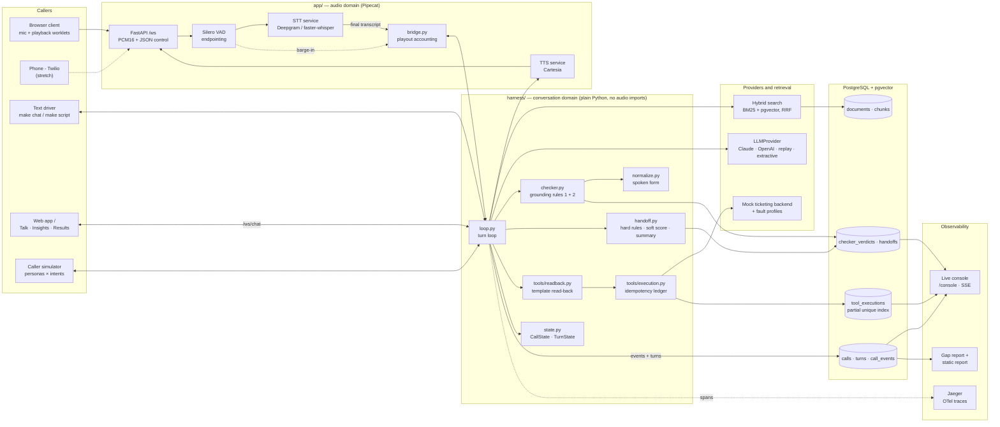

| Layer | Choice | Why |
|---|---|---|
| Audio | Pipecat, Silero VAD | transport, VAD and barge-in events, nothing else |
| LLM | Claude (default), OpenAI, deterministic replay, offline extractive | replay makes the harness testable without a network; extractive runs the whole system with no key, and says so |
| STT | Deepgram (streaming), faster-whisper (local batch) | comparing them is a result in itself |
| TTS | Cartesia | lowest time-to-first-byte, which sits inside the latency budget |
| Retrieval | PostgreSQL + pgvector + full-text, BGE-small embeddings | hybrid, because policy text turns on exact terms like "will-call" |
| State | PostgreSQL | calls, turns, events, the idempotency ledger, eval results |
| Observability | OpenTelemetry → Jaeger, a live console over SSE, a web app, a static HTML report | traces for one call, tables for many, provenance for every number |

---

## 2. The one boundary that matters

> **Pipecat owns audio. The harness owns the conversation.**

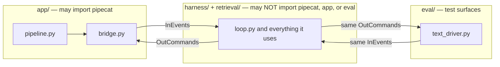

The harness receives events (`TranscriptIn`, `BargeIn`, `SilenceTimeout`,
`Shutdown`) and emits commands (`Speak`, `CancelSpeech`, `EndCall`, `Emit`,
`TurnCompleted`). It never touches an audio device. That is what lets the entire
conversational system run under pytest with typed text in milliseconds. The rule
is enforced by `tests/test_architecture.py` and an import-linter contract, so it
cannot erode quietly.

---

## 3. How one turn flows

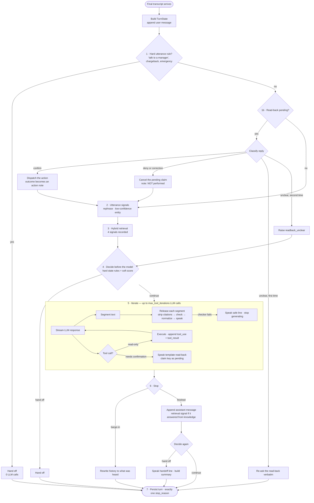

Every turn ends with exactly one `stop_reason`: `answered`, `handoff`,
`budget_exceeded`, `interrupted`, or `error`. The loop asserts on it.

The invariant above all others: **a failure becomes a handoff signal, never an
improvised answer.** Every caller-facing line on a failure path is a fixed template.

---

## 4. From model token to caller's ear

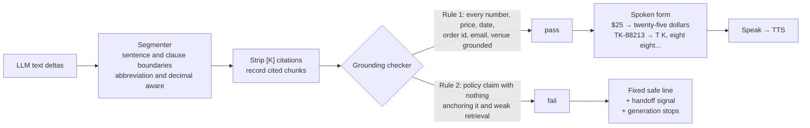

Grounding sources, in order: the retrieved chunk text, tool results from this
turn, and everything the caller has said. Repeating the caller's own order
number back is not a hallucination. The checker never trusts the model's own
`[K]` citations; it checks against the chunk text.

**Declared blind spots**, measured and published rather than hidden:

- **Contradiction.** "Tickets are refundable" against a chunk that says non-refundable.
- **Binding.** The right number attached to the wrong fact.

A deterministic rule cannot see either.

Two first-audio clocks are kept. `first_speak` counts an acknowledgment line
("Let me check that for you"). `first_content` does not, and is the honest
headline.

---

## 5. Tools, read-back, and idempotency

### Read-back before any change to an order

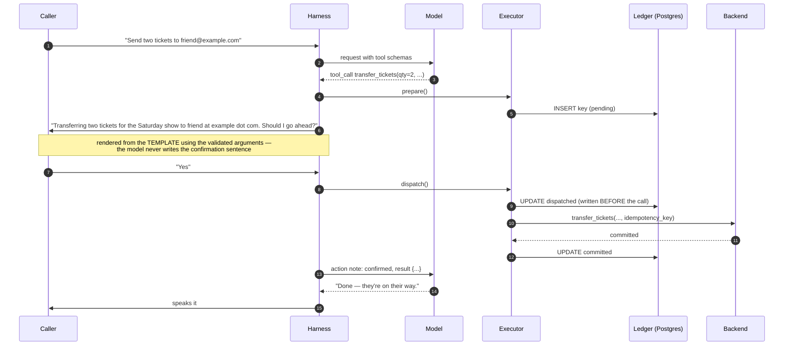

### The execution state machine

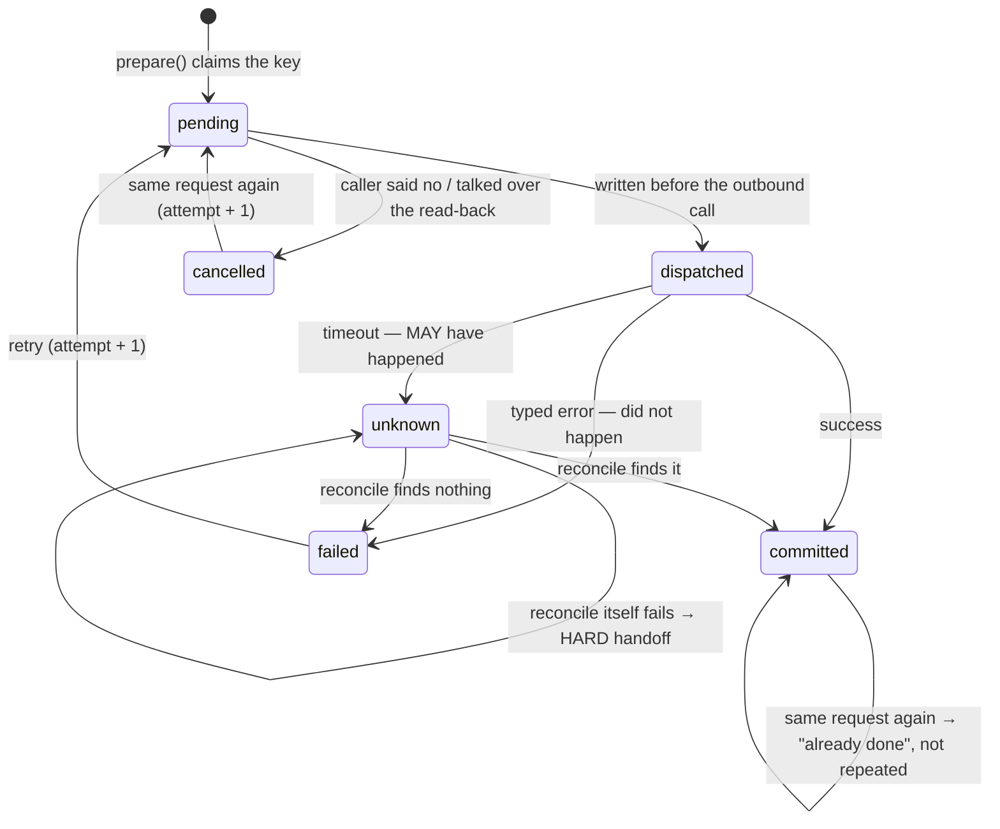

**The one rule:** `cancelled` is reachable only from `pending`. Once a request has
left the process it is resolved or reconciled, never cancelled. Marking a
dispatched call "cancelled" on a barge-in is exactly how a duplicate charge gets
created.

**The enforcement point is the database, not this code.** A partial unique index
on `idempotency_key WHERE side_effecting` makes a duplicate lose to the index,
however it arrives. The key is deterministic, scoped to the call, and covers
only the fields that define the action's identity. Free text like a refund
reason is excluded, so a rephrased retry still collides.

`request_refund` has **no `amount` parameter**. The agent cannot promise money,
because the schema gives it nowhere to put a figure.

---

## 6. Barge-in

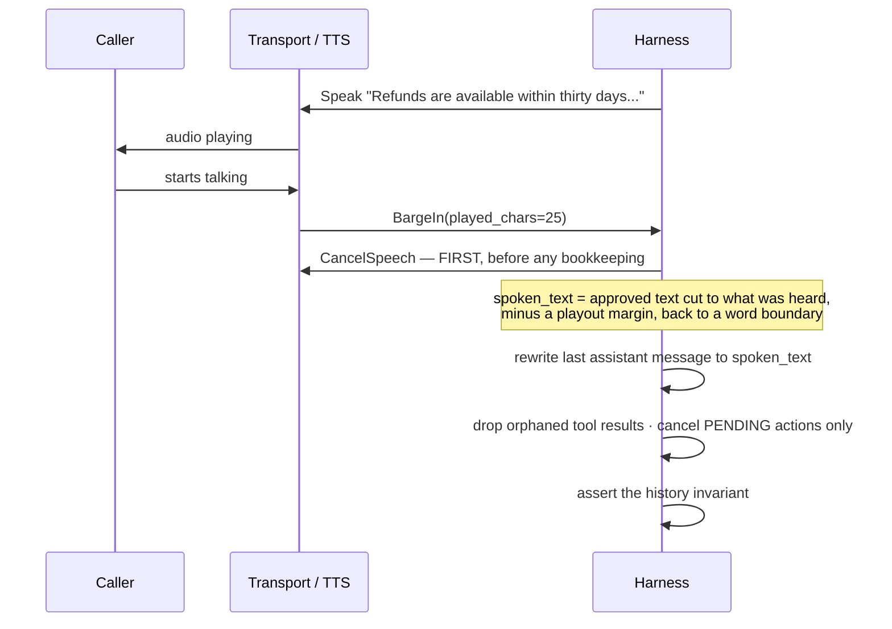

Three texts are kept per turn, and conflating them is the classic bug:

| | |
|---|---|
| `generated_text` | everything the model wrote, including segments the checker rejected |
| `approved_text` | what passed the checker and went to TTS, in spoken form |
| `spoken_text` | what the caller actually heard, after a barge-in |

The estimate deliberately errs toward *"the caller heard less."* The agent may
repeat itself, but it will never believe it said something nobody heard.

A turn completes when its text reaches TTS, not when playback ends. So most
live barge-ins land *after* the turn finished generating, and
`_barge_in_after_turn` rewrites history for those too. Talking over a
read-back always cancels it.

---

## 7. Handoff

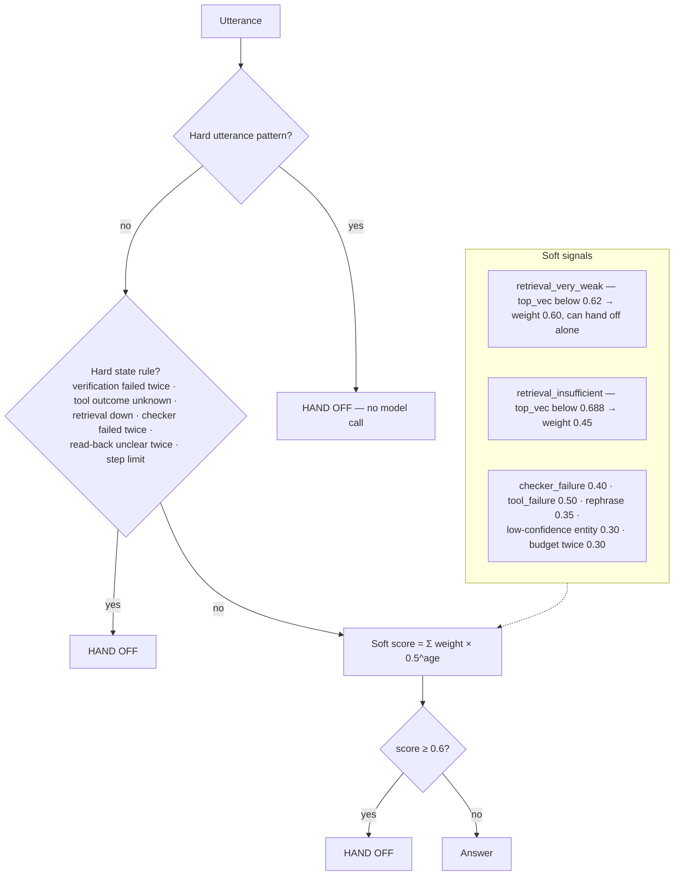

Both retrieval thresholds are **calibrated**, not guessed. They were chosen in
[`results/2026-10-13-retrieval-calibration/`](results/2026-10-13-retrieval-calibration/)
and [`results/2026-10-13-handoff-calibration/`](results/2026-10-13-handoff-calibration/).
The signal is the raw dense cosine of the best chunk. The originally planned
fused RRF margin scored AUC 0.53, a coin toss.

Weak retrieval only counts on turns that answered *from knowledge*. "Yes" or
"send two tickets" retrieves weakly by nature, and counting those would hand off
in the middle of a transfer that was going fine.

The human receives a summary built from call state: what the caller asked, what
the agent did and said, the relevant policy, a suggested next step, and the line
that matters most, **"The agent has NOT promised any refund, credit or other
money decision."**

---

## 8. Data model

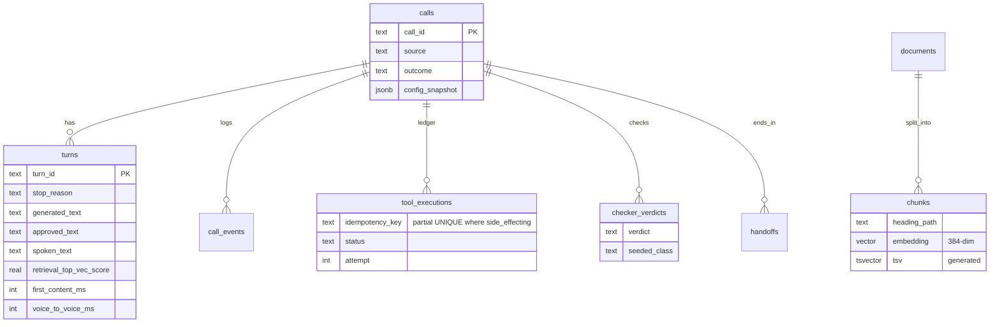

Every call stores a `config_snapshot` (providers, model ids, thresholds, git
sha, corpus hash). A number from two weeks ago is uninterpretable without it.
Full schema: [docs/03-data-model.md](docs/03-data-model.md) and
[`migrations/`](migrations/).

---

## 9. Evaluation and the feedback loop

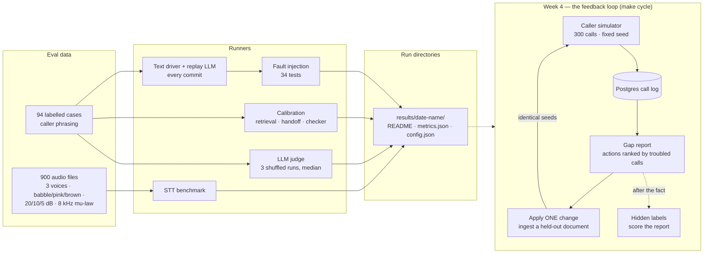

Three of the twelve knowledge-base documents are **held out** at baseline. The
week-4 gap report has to *discover* which missing topic is costing calls. That
makes the before/after containment number earned rather than staged.

It found all three, with the right diagnosis, at ranks 2, 4 and 5. The two actions
above them were real problems nobody planted: refund questions retrieving the
transfers document, and vague callers. Applying the top action that needed no
human author (ingest the weather document) moved containment from **0.737 to
0.793** on identical seeds, with the wrong-answer rate down, not up
([`results/2026-10-15-feedback-cycle/`](results/2026-10-15-feedback-cycle/)).

---

## 10. Latency budget

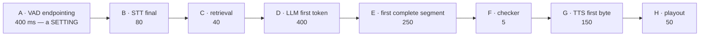

| Reported as | Stages | p50 target | p95 target |
|---|---|---|---|
| voice-to-voice | A–H | ≤ 1375 ms | ≤ 2100 ms |
| harness-side | B–H | ≤ 975 ms | ≤ 1600 ms |

Endpointing is always reported separately, because lowering it buys a better
number while making the agent interrupt people. Stage E is the cost the
checker's existence imposes. It is measured on its own and never folded into
the LLM stage.

No live voice latency has been measured yet; that needs API keys. The static
report refuses to render latency from any run that is not `timing_valid`. See §11.

---

## 11. Measured results

All from [`results/`](results/). *n* is small throughout, and each run README
says so. `make report` renders all of this, with provenance, into
`reports/index.html`.

| What | Result |
|---|---|
| Duplicate side effects under fault injection | **0** across 34 fault tests, including commit-then-timeout, concurrent duplicates and interruption mid-read-back |
| Concurrent identical transfers, real Postgres | **5 → 1** effect, 1 committed row (the race this exposed is fixed; WEEK4.md) |
| Handoff recall / precision (deterministic policy) | **0.86** [0.72, 0.93] / **0.82** [0.68, 0.90], up from recall 0.31 before calibration |
| Hard-rule handoffs | **0** LLM calls |
| Checker: invented numbers / dates / entities | **23/23 · 5/5 · 4/4** caught |
| Checker: fabricated policy claims | **7/8** caught |
| Checker false positives | **2/46** |
| Checker latency | p95 **0.07 ms** per sentence |
| Retrieval sufficiency signal | dense cosine AUC **0.93** vs fused RRF margin **0.51** |
| Retrieval, right document top-1 / top-4 | **11/14 · 14/14** on caller phrasing |
| STT key-entity accuracy, clean → 5 dB | **0.83 → 0.62** (WER only 0.025 → 0.052); spoken emails **0.67 → 0.43** |
| Feedback cycle, containment *(300 simulated calls, offline agent)* | **0.737 → 0.793**, paired +17 / −0, McNemar p = 1.5 × 10⁻⁵ |
| Feedback cycle, wrong-answer rate (guardrail) | **0.136 → 0.113** |
| Gap report vs hidden labels | 3/3 planted gaps found (ranks 2, 4, 5), 1/3 in the top 3, cluster purity 0.985 |

**Not yet measured:** live voice latency, the Deepgram comparison, answer
correctness via the judge, handoffs triggered by a live model's own answers, and
the feedback cycle with Claude as the agent. All of them need API keys.

---

## 12. Running it

```bash
make venv                 # .venv on Python 3.12
cp .env.example .env      # add ANTHROPIC_API_KEY for live chat
make up                   # Postgres :5434, Jaeger UI :16687
make retrieval && make ingest
```

```bash
make test                 # 366 tests, ~20 s, no network
make faults               # fault-injection suite
make demo-scripts         # four scripted demo beats, recorded to Postgres
make dev                  # web app at http://localhost:8088/ · voice client /voice · console /console
make chat                 # text-mode REPL against the full stack
```

```bash
make simulate N=300       # simulated callers → results/<date>-simulation-<label>/
make gap-report           # gap report on the latest simulation run
make cycle                # baseline → gap report → ONE change → identical seeds
make report               # reports/index.html from every results/*/metrics.json
```

With no `ANTHROPIC_API_KEY`, the web app, the voice pipeline and the simulator
all fall back to the offline extractive agent, and say so in a banner and in
every result.

Ports avoid common collisions: 5434, 8088, 16687 and 4319 rather than 5432,
8000, 16686 and 4317. All are overridable in `.env`.

---

## 13. Repository map

```
app/            FastAPI, /ws, Pipecat wiring (the only pipecat import), console, web app (/ws/chat, insights API)
harness/        turn loop, state, checker, normalization, handoff, tools, read-back, assembly
providers/      LLM (Claude, OpenAI, replay, extractive) · STT (Deepgram, faster-whisper, null) · TTS (Cartesia, null)
retrieval/      chunking, corpus linter, embeddings, ingestion, hybrid search
analytics/      event writer (closed vocabulary), persistence, gap report, static report
core/           settings, ids, clock, logging, db, tracing — depends on nothing of ours
domains/        ticketing: 12-document corpus, tools.yaml, handoff.yaml, prompts.yaml
eval/           text driver, dataset, metrics, calibration, checker seeding, synth,
                noise, telephony, STT benchmark, judge, fault-injection suite,
                caller simulator, feedback cycle
demo/           scripted demo beats
migrations/     numbered SQL
results/        one directory per measured run
reports/        the rendered static report
tests/          unit, integration, and architecture-contract tests
docs/           design documents 00–17
```

---

## 14. Documents

| File | What it covers |
|---|---|
| [BUILD.md](BUILD.md) | The week-by-week plan: every task, its dependencies and acceptance criteria |
| [WEEK1.md](WEEK1.md) · [WEEK2.md](WEEK2.md) · [WEEK3.md](WEEK3.md) · [WEEK4.md](WEEK4.md) | What was built, what was verified, what was not |
| [PROJECT_SUMMARY.md](PROJECT_SUMMARY.md) | One-page summary and resume bullets backed by measurements |
| [docs/00-decisions.md](docs/00-decisions.md) | Every locked decision, with rationale and reversal cost |
| [docs/01-architecture.md](docs/01-architecture.md) | Component boundaries, turn data flow, latency budget |
| [docs/02-repo-and-tooling.md](docs/02-repo-and-tooling.md) | Repo layout, dependencies, Docker, Make targets, env vars |
| [docs/03-data-model.md](docs/03-data-model.md) | Complete Postgres schema |
| [docs/04-providers.md](docs/04-providers.md) | STT / TTS / LLM interfaces and implementations |
| [docs/05-retrieval.md](docs/05-retrieval.md) | Corpus authoring, chunking, hybrid search, calibration |
| [docs/06-harness.md](docs/06-harness.md) | State, the turn loop, stop rules, context hygiene |
| [docs/07-tools.md](docs/07-tools.md) | Tool registry, idempotency protocol, read-back |
| [docs/08-checker.md](docs/08-checker.md) | Grounding checker and spoken-form normalization |
| [docs/09-handoff.md](docs/09-handoff.md) | Hard rules, soft scoring, the handoff summary |
| [docs/10-audio-pipeline.md](docs/10-audio-pipeline.md) | Pipecat, endpointing, barge-in, WebSocket protocol |
| [docs/11-observability.md](docs/11-observability.md) | OTel span tree and metric definitions |
| [docs/12-eval.md](docs/12-eval.md) | Eval set, audio, replay, judge, fault injection |
| [docs/13-caller-sim.md](docs/13-caller-sim.md) | The synthetic caller population for week 4 |
| [docs/14-analytics.md](docs/14-analytics.md) | Gap report and the feedback-cycle protocol |
| [docs/15-results-and-claims.md](docs/15-results-and-claims.md) | Reporting rules and what the project can and cannot claim |
| [docs/16-console.md](docs/16-console.md) | The live observability console |
| [docs/17-frontend.md](docs/17-frontend.md) | The web app: views, endpoints, chat protocol, limits |

## The one rule

Never report a number without the run directory that produced it.
