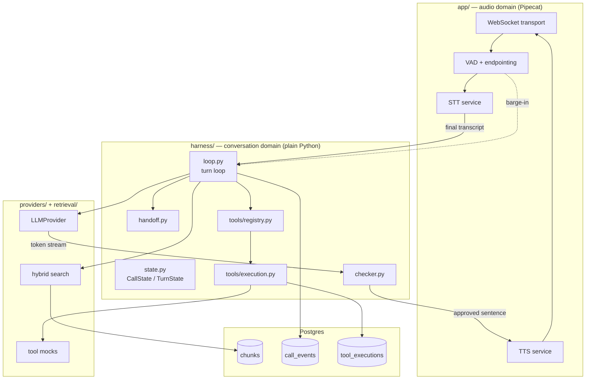

# 01 — Architecture

## 1. The boundary that matters

There is exactly one architectural rule, and everything else follows from it:

> **Pipecat owns audio. The harness owns the conversation.**

Pipecat handles transport, voice activity detection, streaming STT and TTS, and emits
interruption events. It never decides what to say, when to call a tool, or whether to hand
off. The harness is a plain Python module with no Pipecat import. It receives text and
events, and returns text and commands.

The payoff is `eval/text_driver.py`: the entire conversational system runs with typed input
and no audio stack, deterministically, in milliseconds, under pytest. If the harness ever
needs to import Pipecat, that is a design bug.

```
harness/        ← no pipecat import, ever. Enforced by a lint rule (W1-2).
app/pipeline.py ← the only file that knows Pipecat exists.
```

## 2. Component map



## 3. Anatomy of one turn

The sequence below is the contract. Every stage has a span (see
[11-observability.md](11-observability.md)) and a latency budget (§5).

1. **Trigger.** A final transcript arrives from STT, or a silence timeout fires, or a tool
   result lands. The loop constructs a `TurnState` and stamps `t_trigger`.
2. **Pre-gate.** Hard handoff rules run first, before any model call — an explicit request
   for a human or a failed verification never needs an LLM. Cheapest exit wins.
3. **Retrieval.** Hybrid search over the ingested corpus, scoped by `domain_config`. Returns
   chunks with fused scores. `retrieval_top_score` is recorded; it feeds a soft handoff
   signal.
4. **LLM iteration.** Streamed call with the system prompt, trimmed conversation, retrieved
   chunks, and tool schemas. Up to `max_tool_iterations` (3).
   - If the model emits a tool call for a **read-only** tool: execute, append the result,
     iterate.
   - If it emits a **side-effecting** tool call: do not execute. Enter the read-back
     protocol ([07-tools.md](07-tools.md) §4).
   - If it emits text: stream into the checker.
5. **Checker.** Tokens accumulate until a sentence boundary. Each completed sentence is
   checked, normalized to spoken form, and either released to TTS or replaced with a safe
   line plus a handoff signal.
6. **Speech.** Approved sentences stream to TTS. `spoken_text` tracks what was actually
   played, not what was sent.
7. **Stop.** One of `answered`, `handoff`, `budget_exceeded`, `interrupted`. Every turn
   ends with exactly one `stop_reason`; a turn that ends without one is a bug and the loop
   asserts on it.
8. **Persist.** `TurnState` is written to `turns`, and a `turn_completed` event to
   `call_events`.

### Barge-in path

Barge-in is not a turn — it is an interrupt that terminates the current turn and triggers
a new one.

1. VAD reports speech start while the agent is speaking.
2. The loop cancels the in-flight LLM stream and any TTS playout.
3. `spoken_text` is finalized from the TTS playout position.
4. Context hygiene runs: the assistant message in history is truncated to `spoken_text`,
   and tool results that arrived after the interrupt are dropped
   ([06-harness.md](06-harness.md) §5).
5. Any `pending` (not yet dispatched) tool execution is `cancelled`. Anything already
   `dispatched` is **not** cancelled — it is resolved or reconciled
   ([07-tools.md](07-tools.md) §3).
6. `stop_reason = interrupted`. The new user speech produces the next turn.

## 4. Failure domains

| Domain | Failure | Containment |
|---|---|---|
| Transport | WebSocket drops | Call marked `dropped`, state flushed to Postgres on every turn, not at end of call |
| STT | Provider error or silence | Silence timeout → reprompt; two failures → handoff |
| Retrieval | Zero results or DB down | Zero results is a handoff signal; DB down is a hard handoff |
| LLM | Timeout, refusal, malformed tool call | Retry once with a shorter context; second failure → handoff |
| Tool | Timeout, garbage, duplicate | Typed `ToolError` → handoff signal. Never improvised into an answer |
| Checker | Sentence fails | Safe line + handoff signal; generation for the turn stops |
| TTS | Provider error | Fallback line via second provider if configured, else handoff |

The invariant across all of them: **a failure becomes a handoff signal, never an
improvised answer.** There is no code path where an error turns into the model guessing.

## 5. Latency budget

Two numbers are reported, always ([00-decisions.md](00-decisions.md) D11).

```
  caller stops speaking
        │
        ├─ [A] VAD endpointing silence window       target 400 ms   (config, not harness)
        │
        ├─ [B] STT finalization                     target  80 ms
        ├─ [C] pre-gate + retrieval                 target  40 ms
        ├─ [D] LLM time-to-first-token              target 400 ms
        ├─ [E] first sentence completion (buffer)   target 250 ms   ← see note
        ├─ [F] checker + normalization              target   5 ms
        ├─ [G] TTS time-to-first-byte               target 150 ms
        ├─ [H] network + playout start              target  50 ms
        │
  first assistant audio reaches the caller
```

| Metric | Stages | p50 target | p95 target |
|---|---|---|---|
| Voice-to-voice | A–H | ≤ 1375 ms | ≤ 2100 ms |
| Harness-side | B–H | ≤ 975 ms | ≤ 1600 ms |

### Note on [E] — the checker's structural cost

This is a cost the design chooses, and it must be reported as its own line item rather than
buried in the LLM stage.

Streaming TTS normally begins on the first token chunk. The checker cannot run until a
sentence is syntactically complete, so time-to-first-audio now includes generating an
entire first sentence — roughly 200–400 ms. The checker's *own* execution is under 5 ms;
the buffering is the expense.

Two mitigations, both implemented in v1 and measured separately:

- **Acknowledgment bypass.** The first utterance of a turn may be a short non-factual
  acknowledgment ("Let me check that policy —") drawn from a fixed template list. It
  contains no checkable content by construction, so it bypasses the checker and goes
  straight to TTS. This collapses [E] to near zero for the first audio byte while the real
  first sentence is still generating.
- **Clause-boundary checking.** The segmenter breaks on clause boundaries
  (`, and` / `, but` / `;` / sentence-final punctuation) rather than sentences only,
  shortening the buffer for long sentences.

Report time-to-first-audio with and without the acknowledgment bypass. The honest headline
is the one *without* it, since the bypass front-loads filler rather than information.

### Per-turn budget enforcement

`TurnState.latency_budget_ms` defaults to 2500 ms to first audio. On exceeding it the loop
speaks a fallback line and sets `stop_reason = budget_exceeded`. Separately, a tool call
exceeding 700 ms triggers filler speech ([07-tools.md](07-tools.md) §5).

## 6. What runs where

| Process | Contents | Started by |
|---|---|---|
| `voicedesk-app` | FastAPI, WebSocket, Pipecat pipeline, harness | `make dev` / Docker |
| `postgres` | pgvector, corpus chunks, call data | docker-compose |
| `jaeger` | OTel collector + UI on :16686 | docker-compose |
| eval / batch | Replay, judge, caller sim, gap report | `make eval`, `make gap-report` |

Everything except the cloud STT/TTS/LLM APIs runs locally.
