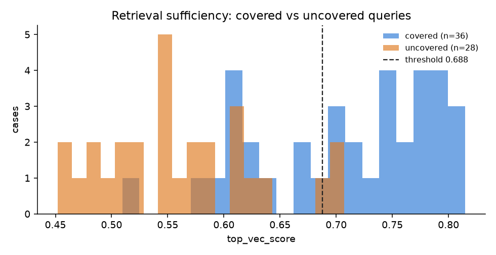

# Retrieval sufficiency calibration (W3-7)

**Date:** 2026-10-13 · **Config:** `config.json` · **Raw:** `raw.jsonl`
BAAI/bge-small-en-v1.5, RRF k=60, top_k=4 · 9 ingested documents, 40 chunks

## 1. What was this run for

To replace the PROVISIONAL "retrieval is insufficient" threshold with a
calibrated one, using the full week-3 eval set instead of the 16 queries in
`results/2026-10-08-retrieval-signal-selection/`.

**Set:** 36 `covered` queries (answerable from an ingested document) and 28
`uncovered` (held-out topics, out-of-scope, and needs no document can meet),
from `eval/dataset/cases.yaml` and `cases_escalation.yaml`. Every utterance
is written in caller phrasing, not corpus phrasing.

## 2. What it showed

| signal | AUC | covered median | uncovered median | threshold @ ≥90% recall | false alarms on covered |
|---|---|---|---|---|---|
| **raw dense cosine** | **0.908** | 0.731 | 0.551 | **0.688** | **13/36 (36%)** |
| raw BM25 | 0.817 | 0.700 | 0.200 | 0.700 | 21/36 (58%) |
| dense margin | 0.776 | 0.055 | 0.012 | 0.048 | 18/36 (50%) |
| fused RRF score | 0.701 | 0.0328 | 0.0323 | 0.0328 | 36/36 (100%) |
| fused RRF margin | 0.530 | 0.0008 | 0.0005 | 0.0017 | 34/36 (94%) |

Recall on uncovered at the chosen threshold: **26/28 = 0.93, 95% CI [0.77, 0.98]**.



### Three findings, in order of importance

**1. The week-2 retrieval accuracy was flattered by its own test set.**
Top-1 document accuracy on the 14 covered cases of the main set is **9/14 =
0.64 [0.39, 0.84]**, against 12/12 in week 2. The week-2 questions were
written by the same person who wrote the corpus, in nearly its phrasing.
Top-**k** accuracy — whether the right document is among the four chunks the
model actually sees — is **12/14 = 0.86 [0.60, 0.96]**, so answers are hurt
less than top-1 suggests.

**2. "No overlap" at n=16 does not survive n=64.** Raw dense cosine is still
clearly the best signal and the fused margin is still near a coin toss, which
confirms the week-2 finding about *which* signal to use. But the distributions
overlap: catching 93% of uncovered queries costs a 36% false-alarm rate.
Combining dense and BM25 scores moved false alarms from 13 to 10–12 — within
noise at this n — so the simpler single signal is kept.

**3. Most false alarms found the RIGHT document with a low score.**
"Do you have anything for people who are hard of hearing?" retrieved the
accessibility document at 0.51; the corpus says "assistive listening", never
"hard of hearing". "Can I bring my guide dog?" — the corpus says "service
animal". This violates the corpus's own writing rule (use the words callers
say) and is a corpus fix, not a threshold fix. It is exactly the kind of gap
the week-4 analytics loop exists to find.

Top-1 misses: `refund_cannot_attend` → transfers doc (it also mentions not
attending); `exchange_other_date` → transfers; `transfer_how` → delivery;
`willcall_what_to_bring` → transfers; `card_keeps_declining` → refunds
(lexical overlap on "card").

The hardest negatives: `account_hacked` (0.707, retrieves transfer docs),
`vip_contents` (0.696, "Harbour Pavilion" matches venue chunks).

## 3. What changed as a result

- `domains/ticketing/handoff.yaml`: `threshold_top_vec_score` 0.65
  (PROVISIONAL) → **0.688**, with this directory named in a comment.
- `retrieval_insufficient` deliberately **stays a soft signal** (weight 0.45,
  below the 0.6 handoff threshold). At a 36% false-alarm rate, letting it hand
  off alone would send a third of answerable questions to a human. W3-8 tests
  this choice directly.
- `PROJECT_SUMMARY.md`: the 12/12 retrieval figure is replaced by these.

## 4. Limits

n=64 is enough to rank signals and set a first operating point, not to quote
a false-alarm rate to two significant figures. All cases were written by one
person. The uncovered class mixes held-out topics with out-of-scope questions,
which behave differently.

## 5. Reproduce

```bash
make up && make ingest
.venv/bin/python -m eval.calibrate_retrieval
```
